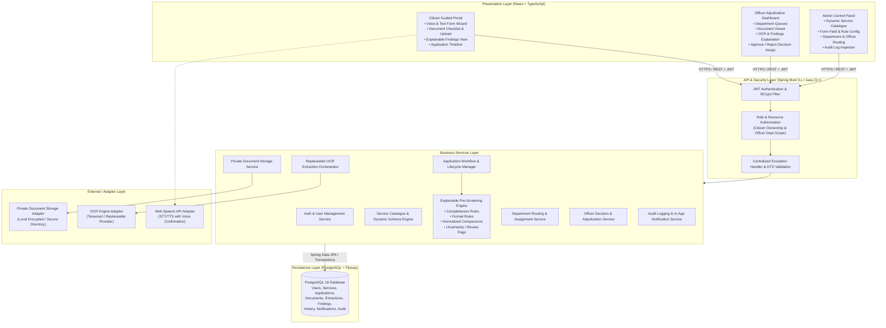
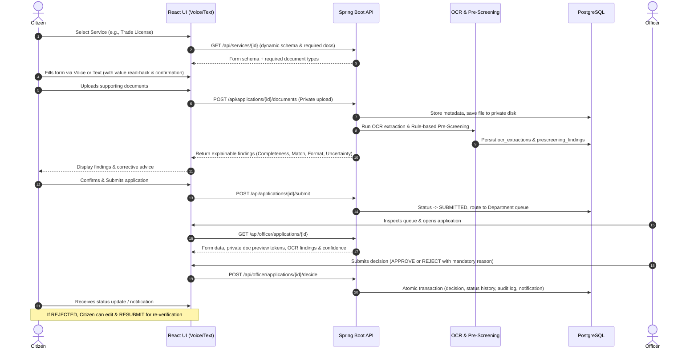
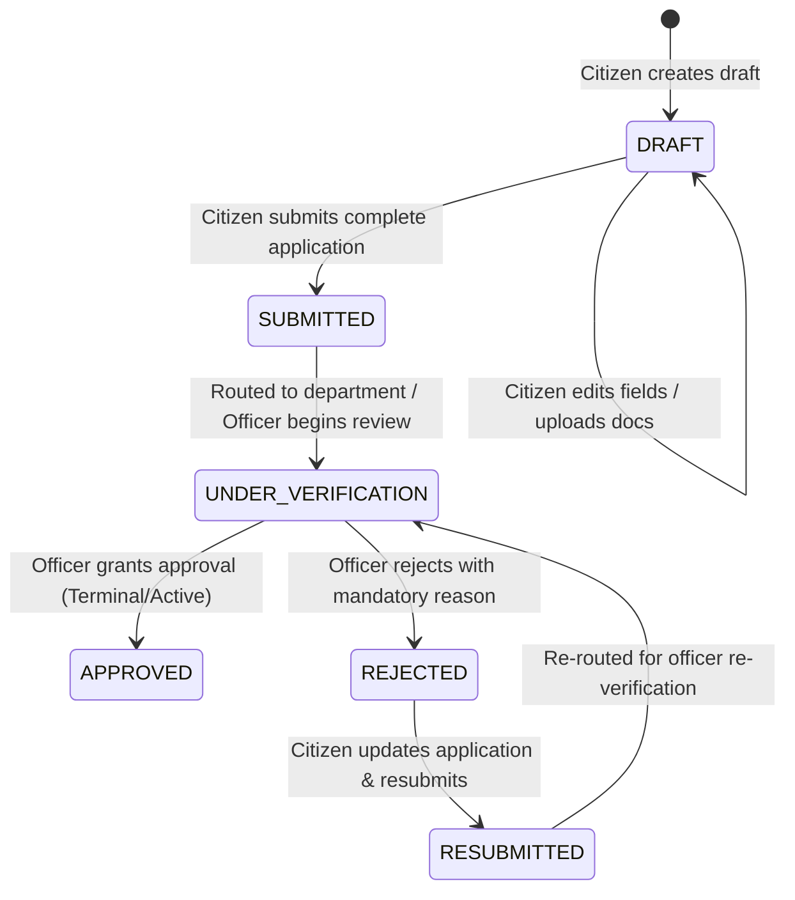

# Smart Digital Licensing Platform - System Architecture & Specification

## 1. System Identity and Objectives
The **Smart Digital Licensing Platform** is an academic prototype designed to evaluate how voice-guided application completion combined with confidence-aware, explainable document pre-screening impacts digital service accessibility and application error rates. Final adjudicative decisions are strictly maintained by authorized human officers.

---

## 2. High-Level Architecture & Component Flow

---

## 3. End-to-End Workflow Sequence

---

## 4. Application Status State Machine

---

## 5. Database Entities & Relational Schema

1. **`users`**: `id`, `name`, `email`, `password_hash`, `role` (`CITIZEN`, `OFFICER`, `ADMIN`), `active`, `created_at`, `updated_at`.
2. **`departments`**: `id`, `code`, `name`, `description`, `created_at`.
3. **`officer_department_assignments`**: `id`, `user_id`, `department_id`, `created_at`.
4. **`services`**: `id`, `code`, `name`, `description`, `department_id`, `is_active`, `sample_fee`, `processing_time_days`, `created_at`, `updated_at`.
5. **`service_fields`**: `id`, `service_id`, `field_key`, `label_en`, `label_te`, `data_type` (`TEXT`, `NUMBER`, `DATE`, `SELECT`), `is_required`, `validation_rules` (JSON), `display_order`.
6. **`required_document_types`**: `id`, `service_id`, `document_code`, `name_en`, `name_te`, `is_required`, `accepted_mime_types`, `max_size_bytes`.
7. **`applications`**: `id`, `reference_number`, `citizen_id`, `service_id`, `status` (`DRAFT`, `SUBMITTED`, `UNDER_VERIFICATION`, `APPROVED`, `REJECTED`, `RESUBMITTED`), `form_data` (JSON), `submitted_at`, `created_at`, `updated_at`.
8. **`application_documents`**: `id`, `application_id`, `document_type_id`, `file_name`, `storage_key`, `content_type`, `file_size`, `file_checksum`, `created_at`.
9. **`ocr_extractions`**: `id`, `document_id`, `engine_name`, `engine_version`, `raw_text`, `extracted_fields` (JSON), `confidence_score`, `processing_status`, `created_at`.
10. **`prescreening_findings`**: `id`, `application_id`, `document_id`, `rule_code`, `field_key`, `outcome` (`PASS`, `FAIL`, `WARNING`, `NEEDS_MANUAL_REVIEW`), `expected_value`, `extracted_value`, `explanation`, `suggested_action`, `confidence`, `created_at`.
11. **`review_decisions`**: `id`, `application_id`, `officer_id`, `decision` (`APPROVED`, `REJECTED`), `reason`, `notes`, `created_at`.
12. **`application_status_history`**: `id`, `application_id`, `from_status`, `to_status`, `changed_by_user_id`, `notes`, `created_at`.
13. **`notifications`**: `id`, `recipient_id`, `application_id`, `title`, `message`, `is_read`, `created_at`.
14. **`audit_logs`**: `id`, `actor_id`, `action`, `resource_type`, `resource_id`, `ip_address`, `details` (JSON without sensitive secrets), `created_at`.

---

## 6. Proposed REST API Endpoints

### Auth (`/api/auth`)
- `POST /api/auth/register` - Register citizen (only `CITIZEN` role; no self-escalation)
- `POST /api/auth/login` - Authenticate, verify BCrypt hash, issue JWT
- `GET /api/auth/me` - Current authenticated user profile
- `POST /api/auth/logout` - Client-side token invalidation / audit

### Services (`/api/services`)
- `GET /api/services` - List active services
- `GET /api/services/{id}` - Full service definition, schema fields & document checklist
- `POST /api/admin/services` - [ADMIN] Create service definition
- `PUT /api/admin/services/{id}` - [ADMIN] Update service definition
- `POST /api/admin/services/{id}/fields` - [ADMIN] Configure service form fields

### Applications (`/api/applications`)
- `POST /api/applications` - Start new draft for a service
- `GET /api/applications/mine` - List citizen's own applications
- `GET /api/applications/{id}` - Get application details (enforces citizen ownership or officer assignment)
- `PUT /api/applications/{id}/draft` - Update form fields in `DRAFT` or `REJECTED` state
- `POST /api/applications/{id}/submit` - Validate and transition `DRAFT` -> `SUBMITTED`
- `POST /api/applications/{id}/resubmit` - Re-validate and transition `REJECTED` -> `RESUBMITTED`

### Documents (`/api/applications/{id}/documents`)
- `POST /api/applications/{id}/documents` - Upload document (validate MIME, size, store with private UUID key)
- `GET /api/applications/{id}/documents/{docId}/preview` - Stream private document with authorized access check
- `DELETE /api/applications/{id}/documents/{docId}` - Remove document while in draft

### Pre-Screening & OCR (`/api/applications/{id}/prescreening`)
- `POST /api/applications/{id}/prescreening/trigger` - Trigger OCR & pre-screening rules on uploaded documents
- `GET /api/applications/{id}/prescreening/findings` - Retrieve explainable findings for applicant or officer

### Officer Adjudication (`/api/officer/applications`)
- `GET /api/officer/applications` - Queue of applications routed to officer's assigned department
- `GET /api/officer/applications/{id}` - Complete dossier (application, documents, OCR findings)
- `POST /api/officer/applications/{id}/decision` - Submit decision (`APPROVED` or `REJECTED` with mandatory reason)

### Notifications & Audit (`/api/notifications`, `/api/admin/audit`)
- `GET /api/notifications` - Citizen / Officer notification feed
- `PUT /api/notifications/{id}/read` - Mark notification as read
- `GET /api/admin/audit` - [ADMIN] Query audit trail

---

## 7. Research Methodology & Baseline Evaluation Plan

### Research Question
> **"Does voice-assisted form guidance paired with confidence-aware, explainable document pre-screening reduce application errors and unnecessary manual adjudication cycles compared to conventional unguided web forms and a baseline OCR exact-matching method?"**

### Evaluation Framework
1. **Synthetic Labeled Dataset**:
   - 60 synthetic applicant documents (driving licenses, utility bills, business certificates) across 5 realistic profiles:
     - Group A: Perfectly matching documents.
     - Group B: Missing required fields.
     - Group C: Format mismatches (e.g. date format variations, slight typo in business name).
     - Group D: Intentional discrepancies (e.g. name mismatch between form and identity document).
     - Group E: Low OCR confidence / degraded quality scan.
2. **Baseline Method**:
   - Standard OCR extraction + exact string comparison on required fields. Low confidence is treated as a hard failure.
3. **Proposed Method**:
   - Confidence-aware extraction + normalized fuzzy comparison + rule explanation + routing uncertain/low-confidence cases to human review rather than penalizing citizens.
4. **Metrics**:
   - Field Extraction Accuracy
   - Mismatch Detection: Precision, Recall, F1 Score
   - False Rejection Rate (punitive AI errors vs proper manual review routing)
   - Adjudication Review Cycle Time

---

## 8. Risk Management Matrix

| Risk | Impact | Likelihood | Mitigation Strategy |
|---|---|---|---|
| **PostgreSQL Service Not Running Locally** | High | High | Document clear OS-specific commands for starting PostgreSQL service (`net start postgresql-x64-18` or `pg_ctl`); provide standard `.env.example`; verify in Phase 2. |
| **Web Speech API Telugu/English Variance** | Medium | High | Implement progressive enhancement: feature-detect Web Speech API; test actual recognition; always provide full text keyboard fallback. Never make voice mandatory. |
| **OCR Misinterpretation on Complex Documents** | High | Medium | Advisory findings only: never auto-reject an application based on OCR output. Flag low confidence for officer review. Record engine name, version, and confidence score. |
| **Unauthorized Data Access (IDOR / Privilege Escalation)** | Critical | Low | Strictly enforce backend role and resource ownership checks on every endpoint (`@PreAuthorize`, custom security expressions); reject any registration requesting `OFFICER` or `ADMIN`. |
| **Sensitive File Exposure** | Critical | Low | Store files outside web root using random UUID storage keys. Serve documents exclusively through authorized streaming endpoints checking ownership. |
