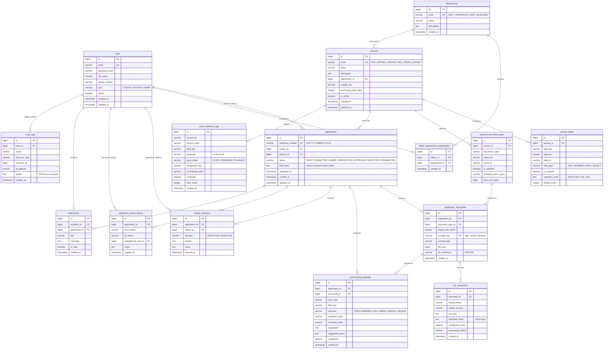

# Database Architecture & Entity-Relationship (ER) Specification

## 1. Relational Entity-Relationship Diagram

---

## 2. Relational Tables & Flyway Schema Evolution

The database persistence layer is version-controlled via Flyway migrations located in `backend/src/main/resources/db/migration/`:

### Migration V1: Core Relational Schema (`V1__init_schema.sql`)
1. `users`: Citizen, officer, and administrator credentials with BCrypt hashes.
2. `departments`: Administrative departments (`DEPT_TRANSPORT`, `DEPT_MUNICIPAL`).
3. `officer_department_assignments`: Junction table enforcing departmental scoping for officers.
4. `services`: Dynamic service catalogue definitions.
5. `service_fields`: Form field definitions with bilingual labels and JSON validation constraints.
6. `required_document_types`: Service-specific document requirements, MIME constraints, and size limits.
7. `applications`: Root application entity with state machine enum and JSON form data.
8. `application_documents`: Private document storage metadata and SHA-256 checksums.
9. `ocr_extractions`: Raw extracted text and JSON key-value pairs with confidence scoring.
10. `prescreening_findings`: Explainable rule evaluation findings with status outcomes.
11. `review_decisions`: Officer adjudication decisions with mandatory rejection reasoning.
12. `application_status_history`: Immutable lifecycle transition audit log.
13. `notifications`: In-app notification feed.
14. `audit_logs`: Platform-wide administrative audit trail.

### Migration V2: Configurable Seed Services (`V2__seed_services.sql`)
- Pre-seeds representative municipal and transport services:
  - `SRV_DRIVING_LICENSE`: Learner's driving license (4 dynamic fields, 2 required documents: ID Proof & Address Proof).
  - `SRV_TRADE_LICENSE`: Commercial municipal trade permit (5 dynamic fields, 2 required documents: Ownership Proof & ID Proof).

### Migration V3: Voice Telemetry & Accessibility Analytics (`V3__voice_telemetry.sql`)
- Introduces `voice_telemetry_logs` to collect privacy-safe telemetry on spoken recognition, normalization efficacy, and fallback rates.

---

## 3. Database Indexes & Performance Optimization

| Table | Index Name | Indexed Column(s) | Purpose |
|---|---|---|---|
| `users` | `idx_users_email` | `email` (Unique) | Rapid credential lookup during JWT authentication |
| `applications` | `idx_apps_reference` | `reference_number` (Unique) | Fast tracking query resolution |
| `applications` | `idx_apps_citizen` | `citizen_id` | Accelerates citizen dashboard query (`my-applications`) |
| `applications` | `idx_apps_status_dept` | `status`, `service_id` | Optimizes department officer queue filtering |
| `application_documents` | `idx_docs_app` | `application_id` | Fast dossier document assembly |
| `prescreening_findings` | `idx_findings_app` | `application_id` | Rapid loading of explainable pre-screening findings |
| `audit_logs` | `idx_audit_actor_created` | `actor_id`, `created_at DESC` | Powers administrative audit trail queries |
| `voice_telemetry_logs` | `idx_voice_telemetry_service` | `service_code`, `created_at` | Speeds up voice telemetry analytics dashboard |
